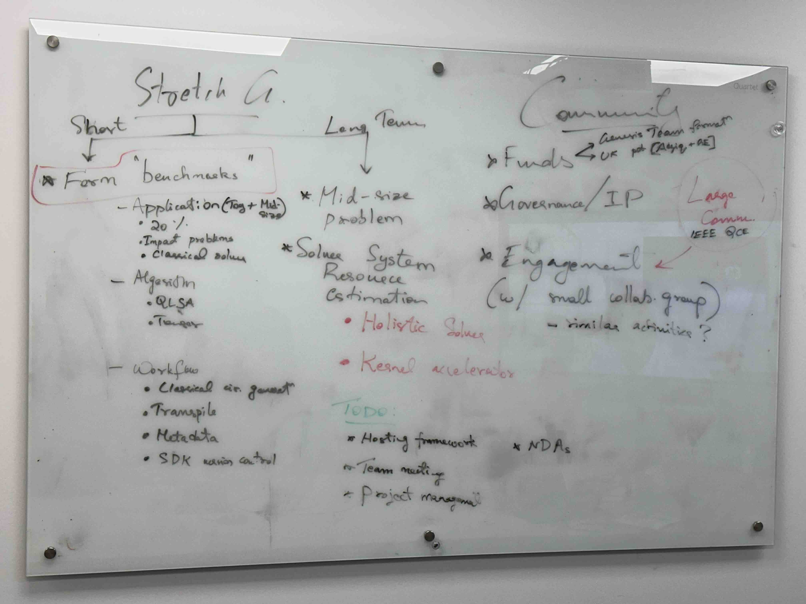

# QC4PDE Meeting : 2026-05-06 : Notes (LEAD)

*Notes captured from whiteboard at the LEAD conference.*

## Stretch Goal Framework

### Short Term

* Form "benchmarks"
    + Application (Toy + Mid-size)
        - ~20% scope
        - Impact problems
        - Classical solver reference
    + Algorithm
        - QLSA
        - Tensor networks
    + Workflow
        - Classical air framework
        - Transpile
        - Metadata
        - SDK version control

### Long Term

* Mid-size problems
* Solver system resource estimation
* Holistic solver
* Kernel accelerator

## Community

* Funds → UK collaborators [Aegiq + RE]; Genesis Team format
* Governance / IP
* Engagement with small collaborative group
    + Similar activities?
* Large community: IEEE QCE

## Action Items

* Hosting framework
* Team meeting setup
* Project management
* NDAs
